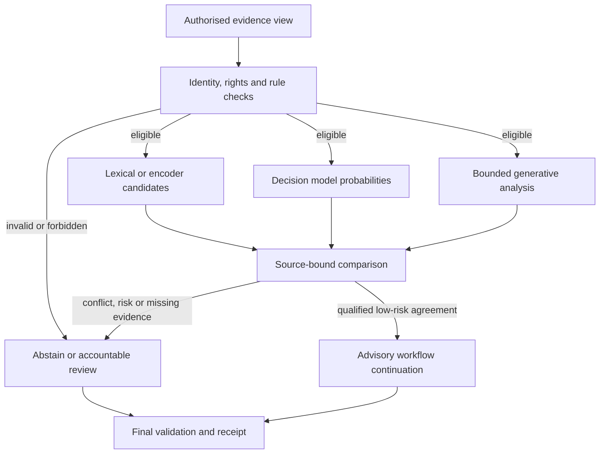

# Decision models specification

## 1. Purpose, status and scope

Evaluate whether non-generative decision models and specialised encoders can improve bounded incident investigation, review, taxonomy coding and agent-workflow tasks when composed with the workbench's deterministic checks and generative models. The intended result is a measured choice of methods for each task, including retention of the simpler baseline when it performs better.

**This delivery is Context → Specification and Plan only.** It creates reviewable design documents, not executable inference adapters, installed dependencies, a new service, thresholds for operational use, or a qualified model. All implementation tasks in [the plan](./plan.md) remain pending. The user's present instruction overrides general continuous-implementation wording in older Conductor records. A later instruction to implement is required before executing this plan; no extra routine approvals are added once that authority exists.

The canonical repository is `edithatogo/rcagent`; the supplied `edithagoto/recagent` returned 404 during preflight. The inspected default branch is `master`, commit `37ca41fa2e7eeee8cc79e24efd5d7c0f915269f3`, tree `038115c101c98efc9438589d9ed1a0efaf294cb8`. This track uses the repository's `<hyphenated-slug>_YYYYMMDD` convention and initial `[ ]` status. It does not reserve a potentially conflicting portfolio number.

### Goals and users

For patient-safety teams, investigators, clinicians, consumer/family liaison staff, accountable reviewers and researchers, provide quicker candidate triage and extraction while preserving source evidence, uncertainty, review responsibilities and the approved incident/records system as the system of record. For coding agents, provide advisory routing and review prioritisation within existing ownership and tool permissions.

Research questions are task-specific:

1. Can a decision model replace a generative classification/judging call without increasing material omissions or unsupported conclusions?
1. Does encoder retrieval followed by bounded decision re-ranking improve coding over lexical retrieval or an encoder alone?
1. Does a rules–encoder–decision–generative cascade reduce errors at useful coverage and an acceptable review burden?
1. Which additional modality, model or verification step contributes independent information, and what does that gain cost?

### Exclusions

This track does not create an autonomous investigator, clinician, statutory reporter or approver. It does not infer culpability, clinician mental states, patient preferences, diagnosis or treatment from a model score. Real private data, new egress, paid compute, model or terminology redistribution, operational deployment and residual-risk acceptance retain their applicable existing decision gates. Public availability alone does not establish reuse rights. Clinical imaging interpretation remains research-disabled. No generic model-serving, vector database, workflow or training engine will be rewritten.

## 2. Repository alignment and ownership

Preflight read the [project index](../../index.md), [product](../../product.md), [guidelines](../../product-guidelines.md), [technical strategy](../../tech-stack.md), [workflow](../../workflow.md), [registry](../../tracks.md), root [agent instructions](../../../AGENTS.md), [constraints](../../../CONSTRAINTS.md), relevant active tracks and representative code. Paths below describe the inspected baseline, not promises of future implementation.

| Existing boundary | Observed implementation | Proposed use and remaining gap |
|---|---|---|
| Canonical data | `tools/evidence_core.py`: `validate_record`, `canonical_bytes`, `fingerprint`; `conductor/schemas/safety-work.schema.json` | Validate case/source/reference/state integrity before accepting any candidate. Store probabilities in a versioned companion until an explicit canonical mapping is accepted. |
| Source spans | `tools/faw07_d0_demo.py`: `inspect_case`; accepted D0 synthetic identity and UTF-8 byte-span inspection | Reuse semantics for exact source anchoring. D0 is a bounded synthetic demonstration; D1 extraction and D2/D3 temporal views remain receiving dependencies. |
| Replaceable operations | `tools/evidence_ports.py`: `Operation`, `OperationResult`, capability/evidence/retrieval/workflow ports | Propose a small `DecisionModelPort` with compatible timeout, idempotency and privacy concepts. Do not overload retrieval verification as inference. |
| Privacy | `tools/privacy_assurance.py`: routing, sensitive-text and adversarial-text scans | Keep deterministic restrictions authoritative. A model may add a concern; it cannot certify anonymity or authorise transmission. |
| Runtime admission | `tools/runtime_lab.py`: discovery, manifests and `route_request`; `evaluation/runtime-lab/registry.json` has an empty model set | Routing currently establishes eligibility, returns `model_executed: false`, and prohibits external execution and remote code. No decision model is currently admitted. |
| Existing generative comparator | `tools/local_model_comparator.py`: admission, prompt construction, bounded local execution and scoring | Design a new task-matched comparator under a new study identity. Preserve historical prompts, consumed protocols and negative results. |
| Wire parsing | `tools/native_completion.py`: pinned native `/completion` response parsing | Reuse duplicate-key/non-finite rejection principles; `/v1/systemone` needs a distinct adapter, not a renamed completion response. |
| Retrieval | `tools/retrieval_system.py`: `LexicalIndex`/SQLite FTS5, source rights, compartment/lifecycle checks and rank fusion | Start with lexical candidate retrieval. Existing fusion combines declared IDs; it is not an installed dense retriever. `grounded_answer` is explicitly claim-link-only. |
| Encoder scaffolding | `tools/encoder_adapter_eval.py`: deterministic hashed-token contract oracle | Reuse fixture/receipt organisation, never label the oracle as model embeddings or measured encoder support. |
| Modalities | `tools/multimodal_fabric.py`: profiles and execution disclosures | Add only separately admitted primitive/modality combinations. Medical-image/ECG interpretation remains disabled. |
| Evaluation | `tools/benchmark_harness.py`: seven-case deterministic suite, manifests and receipts | Add a versioned probabilistic study adapter and maintained metrics. ECE/Brier model evaluation is a gap; existing scores are not redefined. |
| Actions/reviews | `tools/interface_actions.py`: recommendations, transitions, approval and audit | Scores propose review concerns only. Exact artefact-bound accountable-human approval cannot be minted by a model. |
| Orchestration | `tools/autonomy_harness.py` and `tools/workbench.py` | Recommend among already eligible operations; preserve deterministic dependencies, leases, budgets, evidence and ownership. |
| External interfaces | `interface_actions.dry_run_adapter` permits only bounded public/synthetic dry runs and reports `executed: false` | FastAPI and Power Automate are proposed optional adapters, not existing operational integrations. |

The code uses Python ≥3.11, JSON Schema, checked `object` boundaries, `TypedDict`, dataclasses and `Protocol`, with no mandatory package dependencies. Pydantic is not currently installed. Keep JSON Schema authoritative; a future FastAPI/Pydantic adapter may mirror it behind an optional dependency profile. Preserve strict zero-debt typing, existing security checks and the 90% branch-coverage gate.

The historical [local comparator result](../../../evaluation/benchmark/results/local-comparators-v1.md) records 63 schema-valid outputs but only three strict passes across seven synthetic cases and repeated conditions. These are not 63 independent cases. This motivates measuring substantive correctness separately from shape conformance; it provides no evidence for or against a current d1 configuration.

### Receiving programme and non-duplication

| Scope | Existing owner/contract | Relationship to this track |
|---|---|---|
| Scientific methods, labels, grouped splits and analysis | [Track 12](../cognitive-autopsy_20261107/index.md), CAW01–10 and CAW20–22 | Decision-model/encoder conditions extend these work packages; no second corpus, reference panel or study owner. |
| Evidence assurance, demonstration and promotion | [Track 13](../frontier-assurance_20261113/index.md), FAW08–19 | Consume qualified extraction/view boundaries, compare methods and deliver component receipts to the existing integrator. |
| Mortality screening and jurisdiction applicability | [Track 14](../death-review_20261113/index.md) | Reuse its source-qualified death-review profile; no new legal or severity interpretation. |
| AcciMap and HEAPS | Existing PRs [#141](https://github.com/edithatogo/rcagent/pull/141) and [#142](https://github.com/edithatogo/rcagent/pull/142) | Future consumers of candidate factors/QA findings, retaining their graph, process and approval contracts. |
| Shared recommendations and renderer repair | [#143](https://github.com/edithatogo/rcagent/pull/143) and Track 13 | Do not duplicate repairs. Current `render_view` schema validation is not full domain validation; model QA cannot clear that gap. |
| Runtime/model discovery; research publication | Existing [cross-repository contract](../../research/cognitive-autopsy/integration-contract.md) and [local-model note](../local-model-cognitive-autopsy_20261108/index.md) | Consume pinned discovery/admission evidence; `rcagent` owns domain semantics and qualification. No writes to sibling repositories in this increment. |

Archived Tracks 05–08 remain archived. Their contracts are reused without changing historical acceptance or the empty supported runtime set. Active work may proceed in independent lanes only after the integrator allocates non-overlapping files; this planning track allocates no production namespace.

## 3. What is being evaluated

“System 1” and “System 2” are convenient architecture labels, not evidence about human cognition. Here a decision model directly scores a predefined question/label/rubric or returns a bounded typed candidate; a generative model produces a sequence of tokens. A single model forward pass does not mean the complete pipeline has one pass: retrieval, preprocessing, separate questions, validation, calibration and escalation add work.

Strict output shapes reduce parsing failure opportunities; they cannot establish factual correctness, valid ontology selection, calibration under distribution shift or immunity to prompt injection. Sub-100–200 ms, input-only billing, low memory and improved safety are hypotheses to measure on exact workloads. Local inference has compute, memory, energy and maintenance costs even when there are no billed output tokens.

### Candidate and compatibility findings

The [source register](./sources.md) records primary documentation checked for this plan. These are source-backed candidates, not recommendations or successful runtime tests.

| Candidate | Documentation established | Consequence |
|---|---|---|
| `LiquidAI/d1-2B` | Text/image/video decisions and typed answers; model-provided implementation; LFM licence [S01, S11] | First bounded text candidate if its exact executable path is admissible; no automatic admission from open weights. |
| `LiquidAI/d1-Omni-2B` | Audio alongside other modalities; distinct model and limitations [S02] | Separate audio study; do not call audio decisions a transcript or speech recognition qualification. |
| `LiquidAI/d1-omni-600M` | Smaller decision family with tighter input limits and an older capability envelope [S03] | Resource comparator only; no inherited typed-extraction or long-audio support. |
| Hosted `d1.1`, `d1-ultra` | Liquid documents text/images and Noul/Choice/Score; earlier `d1` and `d1-ultra` have gateway links [S04] | Optional public/approved-data comparator. Verify exact gateway/model ID; do not assume `d1.1` is available through every gateway. |
| TypeSafe Jev; Cloudflare Clef | Distinct current decision families and provider contracts [S12, S13] | Potential diverse-family comparators if they add information after the minimum study. No exhaustive model tournament is required. |
| GLiNER | Label-conditioned entity recognition [S16] | Candidate span/mention extractor; still needs exact offsets, assertion handling and local evaluation. |
| ModernBERT, DeBERTa, BioClinicalBERT | Encoder backbones with distinct pretraining [S17–S19] | Need an admitted task head/fine-tuning or embedding recipe; not ready-made zero-shot clinical NER or linkers. |
| SapBERT; KRISSBERT | Biomedical entity representation/linking methods [S20, S21] | Candidate retrieval and contextual disambiguation; neither cosine similarity nor retrieval rank is a calibrated probability of a correct clinical code. |
| MedCAT | Clinical annotation/linking toolkit with separately versioned code and model packs [S22] | Evaluate reuse rather than reimplement linking; inspect the selected code licence, pack, corpus and terminology rights separately. |

| Runtime/transport | Documented capability to investigate | Required restriction |
|---|---|---|
| Transformers reference path | Current d1-2B/Omni cards specify Transformers ≥5.19 and custom model code [S01, S02] | The example's `trust_remote_code=True` conflicts with current runtime admission. Preserve rejection. A reviewed, pinned local package/isolation design must be accepted and tested before use; wrapping it in a service does not bypass the restriction. |
| llama.cpp GGUF | d1 cards identify b11960/v0.8.0+ and `/v1/systemone` [S05] | Documented Noul/single-choice/Score only; multi-label choice, extraction, estimates and boxes are unsupported in the reviewed path. |
| MLX-VLM | Liquid documents ≥0.7.11 and the decision API [S06] | Apple-specific candidate; normal chat/generation calls are not substitutes. Pin model, precision, implementation and hardware separately. |
| Ollama | `/v1/systemone` has its own version, payload and modality limits [S07] | No inference of parity with llama.cpp. In particular video/streaming/tools are not supported by this endpoint; its usage counter need not be zero. |
| ONNX/OpenVINO | Existing stack candidates; reviewed Liquid ONNX documentation does not establish the required d1 heads [S08] | Export/parity spike only. Unsupported remains unavailable until exact head/output parity and probability drift are measured. |
| Liquid / other hosted providers | Liquid uses `/decisions/v1/systemone`; wire contracts differ [S04] | Explicit provider adapter, credentials, allowed data and egress; never an automatic local failure fallback. |

A model identifier, runtime package version, quantisation and supported primitive form one qualification tuple. Quantisation can alter outputs [S09]. Do not transfer calibration across tuples, changed prompts/rubrics, candidate-generation procedures, ontology releases, languages or populations outside its validated envelope. Different per-case Top-K lists may be covered by one prospectively qualified procedure, including its K/selection rules and label semantics; each actual list is still hash-bound to its request/result. Current lower version bounds are documentation observations; implementation must pin exact compatible versions and dependencies rather than installing an open-ended range.

## 4. Functional requirements by workflow

### DM-F01: Intake and completeness

Run required-field, file-integrity, size, source-rights and privacy checks first. Use Noul for separate questions such as whether an account states a time, response, patient/family concern or unresolved hazard. Produce a list of missing/uncertain facts, anchored to the submitted fields and evidence view. Distinguish an absent statement from proof that care did not occur.

PII detection combines existing deterministic scans with an optional encoder/decision flag. A low PII score never permits remote transfer, declassifies a record or certifies de-identification. Test identifiers in free text, metadata, images, audio, split tokens, rare combinations and quoted instructions. An incomplete urgent report remains available for escalation; completeness gating must not delay an urgent human response.

### DM-F02: Severity, acuity and potential reportability

Use Score for a declared ordinal rubric and Noul for separately specified high-severity/sentinel concerns. Keep actual harm, potential harm, urgency and reportability as different constructs. `ISR`, `SAC` and `P1–P4` are not interchangeable scales. A jurisdiction profile must specify issuing authority, version/effective date, direction, class meanings and any approved mapping; no scale is inferred from a name or integer order.

Preserve the whole ordinal probability vector and the severe-class tail probability. A median or mean must not conceal a small but material severe tail. Calibrate a sensitive review threshold on an independent calibration partition; retain uncertainty and subgroup precision. A confirmed applicable deterministic flag always escalates, even if every model disagrees. Missing jurisdiction, conflicting sources, uncalibrated scores or insufficient evidence produce review/abstention. Models neither determine a statutory duty nor automatically close or suppress a potentially reportable event.

### DM-F03: Team, skill and agent routing

Use exclusive Choice for one permitted destination and multi-label Choice only where multiple independent tags/teams are allowed. Include `none_of_the_above` and `insufficient_information` in the task design, with an explicit ambiguity path; do not force assignment. Clinical governance, specialist reviewers and triage/investigate/report/track skills are candidate destinations, not invented organisational teams.

For tool selection, restrict candidates before inference to authorised tools and current lane/file ownership. After inference the deterministic broker independently checks permissions, prerequisites, cost and idempotency. The result is a suggestion, never executable shell text, a tool argument authority grant, a merge approval or evidence of task completion. Test allowed-looking but unauthorised destinations and stale ownership.

### DM-F04: Facts, quantities and timeline candidates

Use typed text/number/date answers to propose source-linked candidates. Preserve original text, exact source identity, offsets, raw units, normalisation and ambiguity. Check date validity, number syntax, units and bounds deterministically. Extraction does not recommend dosages or infer missing doses, years, time zones or event times.

`found < 0.5` means missing/null for the documented extraction interface. Equality at `0.5` is a boundary test, not an acceptance threshold for safety. A locally calibrated acceptance threshold may be higher. Distinguish missing, malformed, unsupported, out-of-range and conflicting answers. A generated or estimated quantity is never admitted as a verbatim fact. Range estimates remain a separate, disabled-by-default task.

Translate provider character/token offsets to original UTF-8 half-open byte spans using an auditable transformation map; reject ambiguous or nonmatching spans. Keep event time, documentation time and recipient-specific availability separate. Incomplete dates remain intervals or unknown precision; a typed ISO date cannot manufacture evidence. Timeline construction and cutoff entitlement consume the existing CAW10 / D2–D3 receiving contracts.

For boxes, bind page/image identity, original dimensions, rotation/crop transformation and coordinate system. Validate bounds and ordered corners, then map back to the original evidence. A region is a localisation suggestion, not confirmation of a clinical interpretation.

### DM-F05: Terminology and taxonomy coding

Use the following bounded funnel:

1. Admit the source view and exact terminology/taxonomy edition, rights, language and jurisdiction.
1. Identify a mention using lexical/rule methods or an admitted GLiNER/task-specific encoder; preserve negation, uncertainty, temporality, experiencer and original span.
1. Retrieve candidates using existing lexical search; optionally add SapBERT or another admitted encoder and a local FAISS/Qdrant index where recall/resource evidence warrants it.
1. Freeze the Top-K candidate IDs, descriptions, edition, retrieval scores, ordering and candidate-set hash. Supply a genuine NIL/no-match path and insufficient-evidence path.
1. Use exclusive Choice to disambiguate one mention when exactly one concept is appropriate; use multi-label Choice for genuinely independent factors/criteria or multiple concepts. Do not require independent probabilities to sum to one.
1. Apply deterministic candidate membership, code validity, hierarchy/exclusion and version rules; retain contradictions and map only reviewed candidates to the authoritative coding workflow.

Measure mention recall, retrieval recall@K and re-ranking performance separately. Re-ranking cannot recover a concept absent from its candidate set. Repeat with missing true concepts, near synonyms, inactive codes, candidate-order changes, mixed granularity, uncertain/negated/history/family mentions and multiple competing meanings. Calibrate selection for the candidate-generation procedure; changing K changes the conditional question.

SNOMED CT, ICD-10 and ICD-10-AM are distinct edition/governance choices, not free-text labels to interchange. Terminology licences and redistribution rights must be verified for the selected material. WHO's ICPS conceptual framework is not itself a ready-made classification [S23]; define and version any local coding profile. Human Factors Analysis and Classification System (HFACS) dimensions need a versioned rubric and rights review. A factor tag is an analytical hypothesis, not causation or individual fault. Do not publish restricted terminology bundles or represent SNOMED-to-ICD mappings as automatically lossless.

### DM-F06: Multimodal evidence screening

Begin with synthetic/public-rights-cleared screenshots, document regions and non-diagnostic hazard images. Compare direct vision decisions with existing native text/OCR representations, measuring reading order, numbers, units, missing pages and region fidelity. Add audio only after a separate capability/rights admission; compare direct audio decisions with an independently measured transcript route. Preserve timestamps, uncertain speaker attribution and provenance without inferring speaker identity.

Test low resolution, rotation, contradictory captions, hidden text, image prompt injection, noise, accents, number/negation errors, missing media and unsupported duration. Count fallback and truncation; never silently truncate a safety-relevant input. Copies, OCR and recordings of the same source do not become independent witnesses. DICOM, radiology, pathology and physiologic diagnosis are outside this track's initial claims.

### DM-F07: Investigation and corrective-action QA

Use separate Noul/Score rubrics for evidence linkage, uncertainty preservation, alternative explanations, patient/family concern coverage, systemic mechanisms, recommendation specificity, owner/timeframe and process/outcome/balancing measures. The question must be auditable and tied to source spans. A single composite “good RCA” score must not hide a critical failure.

Compare a narrative's explicit risk claims with scores on the same harm construct and permitted evidence. Surface discrepancy rather than rewriting the narrative into false consensus. Keep poor text quality distinct from unsupported clinical judgement. Recommendations remain proposals; action completion is distinct from effectiveness. Existing artefact-bound approvals and state transitions remain authoritative.

## 5. Additional repository-specific opportunities

| Use case | Small extension | Test that decides whether it adds value |
|---|---|---|
| Evidence sufficiency and loop control | Choice among continue with available evidence, ask a specified clarification, use an eligible tool, or abstain | Premature stopping, unnecessary calls, unresolved critical gaps and budget exhaustion. When2Call inspires task design but is not a ready-made controller [S14]. |
| Context/RAG filtering | Parallel relevance/support/conflict scores after rights and temporal filtering | Critical-information recall at a fixed context budget; do not remove low-scoring contradictory or safety-critical spans solely on relevance. |
| Semantic claim checking | Supported/contradicted/insufficient labels after exact identity/span checks | Correct citation with wrong claim, shuffled evidence, hypothesis-only shortcuts and natural versus injected errors. |
| Patient/family concern audit | Match the source-linked concern inventory to responses/findings | Missed concerns and invented preferences; CAW20 retains ownership of the reference procedure. |
| Prompt-injection screening | Add suspicion flags to existing deterministic scans | Attack success against the complete broker, including image/quoted-policy injection; a low model score never confers tool or network permission. |
| Policy applicability/drift screening | Rank possibly stale or mismatched references for review | Incorrect jurisdiction/effective-date and misleading authority labels; source registry decides applicability. |
| Coding and engineering support | Rank review hotspots, classify failures and suggest eligible test groups | Missed defects versus actual tests/static checks; advisory output cannot change gates, skip required tests or authorise merges. |
| Recommendation/simulation scoring | Rank explicitly specified synthetic candidate actions against a declared rubric | Compare against a separately held oracle and balancing measures; score is not causal effectiveness or a valid value-of-information model. |

These are conditional extensions, not prerequisites for a useful intake/routing experiment. Formal value-of-information or causal simulation belongs to the existing CAW14/24 interfaces and requires declared states, priors, likelihoods, utilities and evidence budgets.

## 6. Triangulation and abstention architecture

Use the existing [triangulation contract](../../research/frontier-assurance/triangulation.md) and [verification/reuse design](../../research/cognitive-autopsy/verification-and-reuse.md). Preserve four different provenance axes: source origin, analysis method, model/training lineage and modality/transformation. Agreement is an observation. It is not proof, independence or an authority decision.

The diagram is a comparison architecture, not a requirement to run every model on every case. The evaluated cascade may use a cheap path first and invoke an admitted verifier/generative arm only when a frozen routing policy calls for it. Every arm receives the same permitted decision-time view; excluded later outcomes never enter a model context, retrieval cache, verifier or rendered report.

### Reconciliation rules

| Condition | Required disposition |
|---|---|
| Invalid source/case/span, privacy violation, unauthorised operation or hard rule failure | Reject or quarantine. No model majority, confidence or fallback can override it. |
| Applicable deterministic high-severity/reportability trigger | Escalate to the named accountable pathway; models may add context but cannot veto it. |
| High-severity model signal at the calibrated review threshold | Request review even if the generative narrative sounds reassuring; show the underlying distribution and source. |
| Multiple sources conflict on a material fact | Preserve source alternatives and provenance; request adjudication or further evidence. Do not average dates, doses or incompatible accounts. |
| Methods disagree or are high-entropy/out of distribution | Abstain or use a pre-authorised bounded local escalation; then human review if unresolved. |
| High agreement, valid evidence and task-qualified low-risk thresholds | Permit only the defined reversible step, such as attaching candidate tags or prioritising a queue. Do not auto-close, approve, disclose or make a clinical/legal decision. |
| Provider timeout, malformed answer, missing calibration, unsupported primitive or unavailable modality | Preserve the error; use an already authorised deterministic/manual path. No hidden cloud, unqualified model or broader view fallback. |

A calibrator may combine methods only if fitted on development/calibration data and independently assessed as part of the whole cascade. Do not multiply probabilities assuming independent witnesses, average incompatible rubrics or treat the generator and its own critic as independent judges. Record joint errors and whether disagreement reveals a material error.

Single-choice entropy, normalised by the number of options, and per-label Bernoulli entropy for multi-label tasks are distinct diagnostics. They are not universal uncertainty or safety thresholds. An empirically overconfident wrong model may have low entropy; retain distribution-shift, source-quality and severe-tail triggers. Unknown uncertainty produces abstention, not invented numerical certainty.

## 7. Interface and operational design

The [proposed contracts](./contracts.md) specify inputs, discriminated outputs, schema fragments, cross-field validators, versioning and error semantics before implementation. The required primitives are Noul, exclusive/multi-label Choice, ordinal Score and typed text/number/date/box/boxes. Each result binds to a case, immutable evidence view, question/rubric/candidate set, provider/model/runtime/precision, and calibration/threshold versions.

Provider-native `score`, confidence and probability semantics remain visible. In particular, the reviewed open d1 `score` is a median, whereas hosted documentation describes a weighted position [S01, S04]. A canonical expected ordinal index may be calculated only as an explicitly named diagnostic when spacing is justified. It is not substituted for an ordinal category or a calibrated probability of safety.

### Local service pattern

Prefer an in-process or existing bounded worker adapter first. If isolation or consumer access justifies a service, use an optional warm FastAPI/Pydantic wrapper with an exact schema-version handshake and existing operation concepts. Bind locally or to an approved internal interface; require authentication, caller authorisation, bounded concurrency/queue depth, input/output budgets, deadline/cancellation, health/capability checks and audit receipts. Neither localhost nor a container alone establishes isolation.

Pin weights, tokenizer, processor, model code, runtime, lock, artefact hashes and device profile. Perform any downloads in an explicitly admitted preparation step; runtime use has no implicit network fetch, arbitrary URL/file resolution, telemetry or remote-code loading. Test attempted egress, DNS, logs, caches, temporary files, path traversal, request smuggling, duplicate keys, media bombs and stale/replayed receipts. Sidecars obey the same privacy and remote-code admission rules as in-process execution.

Power Automate or another enterprise consumer requires its own approved connector/gateway and records-system boundary. A cloud flow is not automatically local because inference runs on premises: content, request metadata and flow history may cross a boundary. Default to public/synthetic dry runs and minimal approved metadata until the complete path is qualified. No connector, credential or deployment is created by this plan.

### Resource and lifecycle requirements

Keep the portable core free of Transformers/Torch, Pydantic/FastAPI, vector, modality and hosted SDK dependencies. Reuse optional upstream packages after exact-version compatibility/licence review. Cold start, warmed inference, preprocessing, queueing, retrieval, calibration, fallback and end-to-end latency are measured separately. Unsupported hardware returns a declared unavailable state.

Any change to the source view invalidates its cached decision; it does not require fitting a new calibrator for every case. Changes to model/tokenizer, precision, runtime, rubric/prompt, candidate-generation procedure, ontology, calibrator or the declared target population require revalidation of the affected calibration/threshold binding. The calibration manifest states which varying candidate sets and equivalent presentation changes are covered; an unsupported change cannot reuse that claim. Schema major changes fail closed; additive evolution requires round-trip and legacy-reader tests. Disable an optional adapter to roll back, retaining original evidence and negative receipts. Never roll back privacy checks to restore an unauthorised flow.

## 8. Validation and verification design

### Architecture and contract verification

Before model calls, validate the proposed schemas and mocked adapters against the concrete rejection matrix in [contracts.md](./contracts.md). Use fixture-first/red–green–refactor work under the existing workflow: capture an independently specified failing example, implement the smallest adapter, rerun focused checks, then the applicable full phase gate. Exact error states and evidence preservation matter more than matching implementation internals.

Require unit/property tests for invalid probabilities and labels, exclusive versus multi-label semantics, ordinal median/expectation separation, null/`found` boundaries, span/unit/calendar validity and image coordinates. Require integration tests for capability negotiation, timeouts/cancellation, unavailable providers, bounded retries, missing calibration, stale hashes, source-view isolation, candidate loss, threshold escalation, approval preservation and local-only fallback. Mocked/model-free passes qualify contracts only; local-model fixtures require actual exact-tuple inference receipts.

Existing evidence, privacy, runtime, retrieval, benchmark, interface, autonomy and native-completion regressions remain enabled. Do not alter historical frozen studies, typing baselines, coverage requirements or shared gates. Independent agent reviewers inspect acceptance, evidence integrity and safety/privacy; their agreement is engineering/research-plan assurance, not independent human clinical validation.

### Dataset, reference and split design

The first development set uses original synthetic incident fixtures and admitted public examples, stratified across all seven requested workflows, absent/contradictory facts, rare serious concerns, language/format shifts and negative cases. Existing seven-case fixtures are smoke/compatibility evidence only. A development pilot of roughly 30–50 independent case families may estimate feasibility and annotation burden; it cannot establish a rare-event safety claim.

Under Track 12, determine whether any exact HDC snapshot/task already falls within the standing approval and rights record before use; do not seek blanket reapproval of that programme. New data modalities, identifiable content or broader reuse require only their genuinely new decisions. Clinical/ontology subsets must record exact dataset and terminology licences; restricted corpora or private benchmarks remain unavailable unless access and use are established.

Group linked reports, versions, persons/encounters where permitted, templates, renders, copied sources and all counterfactual variants before splitting. Separate development/training, calibration/threshold selection and untouched final test families. Fit vocabulary, retrieval adaptations and calibrators without holdout answers; permitted source retrieval during testing must not expose reference labels or later outcomes. Register a temporal or external-source replication and report domain shift.

Construct references independently of the system under test. Agent panels can check synthetic rules and engineering rubrics; reference clinical interpretations, user-workflow claims and cultural authority require appropriate evidence and accountable expertise. Record annotator/reviewer class, rubric, uncertainty, disagreements, adjudication and any model assistance. A generator cannot be the sole author and judge of its own test truth.

### Matched experimental arms

| Arm | Definition | Interpretation |
|---|---|---|
| R | Deterministic/rules plus lexical retrieval | Minimum baseline and intact hard boundaries. |
| C | TF-IDF/regularised classifier; optional admitted encoder | Conventional/non-generative comparator with the same labels and annotation budget. |
| G: standalone LLM | Competent generative model answers the bounded task, with the same mandatory privacy/identity checks | “Standalone” excludes extra semantic verifier models; it never removes mandatory safeguards. |
| D: decision model | Direct decision primitive; common retrieval where the task requires it | Measures replacement of classification/judging, not open-ended narrative capability. |
| H: triangulated hybrid | Frozen rules/retrieval/decision/generative cascade with explicit escalation | Measures whole-system errors, useful coverage and review burden. |

Match evidence, question/rubric, candidate IDs, split, annotation access and development budget. State when cost/compute is constrained or deliberately varied. Add bounded ablations: retrieval only versus re-ranking; rules+G; G plus its own critic; G plus a diverse verifier; full cascade minus each contributor; direct modality versus OCR/transcript; quantised versus reference precision. Do not use an intentionally weak prompt as the sole generative comparator.

Decision-only cannot produce an unrestricted investigation report. For report-level comparison, keep the same generator and compare its unverified output with each verifier/cascade. Measure natural errors separately from injected faults. AA Decision Index provides external methodology, not incident validation [S15]; use original symmetry-inspired variants because AA-Symmetry is private. Equivalent rewording/order should preserve mapped answers, while genuine changed evidence should change them. Invariance without cue sensitivity can be a failure.

### Required outcomes and analysis

| Dimension | Required measurement |
|---|---|
| Discrimination | Per-class sensitivity, specificity, precision, F1, confusion matrices, AUROC and especially precision–recall curves for rare labels; micro/macro denominators explicit. |
| Calibration | Binary Brier `mean((p-y)^2)`; multiclass sum-over-classes Brier with scale stated; multi-label per-label and macro Brier; ECE with fixed development-chosen bins plus classwise reliability plots, bin counts and case-clustered uncertainty. Report raw and calibrated probabilities. |
| Ordinal outputs | Category/tail calibration, severe under-triage, ordinal confusion and ranked probability score [S34]; weighted agreement only with declared weights. Do not assume equal clinical distances. |
| High-severity gates | Sensitivity/FNR at the frozen review threshold, positive-case denominator, missed-event category/severity, exact binomial interval where independence is justified or case-clustered interval otherwise; also PPV and reviewer workload. |
| Extraction | Exact span/byte attribution, value/unit/calendar fidelity, null detection, field-level precision/recall, interval/partial-date preservation, box overlap and correct region/page identity. |
| Linking | Mention recall, recall@K, NIL detection, candidate-conditioned top-1/multi-label scores and end-to-end code accuracy; include the cases where retrieval lost the truth. |
| Abstention/cascade | Coverage, selective risk–coverage curve, false reassurance, unnecessary escalation, rescue rate, false blocking and end-to-end material error over all eligible attempts. |
| Triangulation | Joint-error/overlap matrix, conditional miss probability, independent-origin count, disagreement yield and correction burden; stratify correlated source/method/model families. |
| Performance and cost | Cold/warm p50/p95/p99, timeout/error/OOM rates, throughput under stated concurrency, RSS/VRAM, input size/modality/K, billed tokens/requests and local resource costs; include retries and fallbacks. |
| Robustness and equity | Option/order/paraphrase/negation controls, noisy/long/missing inputs, new sources/time/languages and justified subgroups with uncertainty; no unsupported demographic or cultural-safety claim. |

Use maintained scikit-learn metrics/calibration and applicable Inspect AI orchestration through thin adapters [S24, S25]. ECE depends on bins and sample size; a low ECE alone is not sufficient. Brier combines calibration and discrimination and must not be called a pure calibration error. LLM self-reported probabilities are evaluated as predictions, not accepted as calibrated confidence; where probabilities are unavailable, declare the metric unavailable rather than inventing them from fluent prose.

Freeze numerical thresholds, margins, minimum coverage, primary contrast, sample size/precision, exclusions and stopping rules before unblinding the test set. Select thresholds using calibration data only. For a research illustration, zero misses among 59 independent positives gives a one-sided 95% exact lower sensitivity bound just above 0.95; repeated variants are not additional positives. This illustrates why small pilots cannot certify rare-event safety, and is not a proposed clinical acceptance target.

Primary comparison: paired case-family difference in material errors/omissions at prespecified useful coverage, alongside severe-event miss rate. Use family-clustered bootstrap or a prespecified suitable model, report confidence intervals and denominators, and identify exploratory comparisons/multiplicity. Time and cost are secondary to safety-relevant correctness. All-abstaining systems cannot win by omitting difficult cases; timeouts, malformed answers and unavailable capabilities remain in attempted-case and resource accounting.

### Promotion and stopping rules

Before a research tuple can be described as qualified for a bounded task:

1. All applicable deterministic, privacy, provenance and contract controls pass, with no model override of hard failures.
1. Calibration/threshold identities and grouped split are frozen and auditable; minimum coverage and safety-relevant margins have been specified prospectively by the owning study.
1. The paired held-out comparison meets those margins with the declared uncertainty. If sample size cannot resolve them, report inconclusive; do not lower margins after looking.
1. Additional complexity provides useful error/coverage/burden or resource improvement over the strongest suitable simpler arm, with correlated-error limitations retained.
1. Actual target-runtime/device measurements and independent review support the exact claim. Operational deployment remains a separate decision and validation scope.

No universal `0.5`, ECE cutoff, severe-event sensitivity target or latency promise is set for deployment by this plan. Until the study's numerical operating envelope is frozen and supported, automated high-stakes negative resolution is disabled. Failure to qualify a model, unsupported capabilities and retaining rules-only are valid completed research outcomes, not reasons to weaken the gate.

## 9. Acceptance criteria and traceability

| ID | Requirement | Future acceptance evidence | Plan |
|---|---|---|---|
| DM-A01 | Source-qualified candidate/runtime/licence inventory; no claimed model support from documentation | Exact immutable tuple, rights and capability manifest; incompatible tuple rejects | DM01, DM03 |
| DM-A02 | Provider-neutral primitive contracts, including all typed outputs and explicit uncertainty | Schema and wire fixtures, cross-field/negative/property tests, backwards compatibility | DM02–DM03 |
| DM-A03 | All seven core workflows and additional repo uses have bounded design mappings; empirical scope is declared | Design coverage for every requested use; source-linked fixtures and receiving-owner agreement for the frozen study's included tasks; other tasks remain unsupported | DM04–DM07 |
| DM-A04 | Rules/encoder/decision/generative and multi-source triangulation preserve disagreement | Decision-table tests, hard veto, origin lineage, holdout joint-error and ablation results | DM05, DM08–DM09 |
| DM-A05 | Any included ontology retrieval/re-ranking has exact editions, NIL and assertion semantics | If DM06 is included: recall@K, candidate membership, negation/temporality and end-to-end coding results; otherwise an explicit unsupported/deferred disposition, not a coding qualification | DM06, DM09 |
| DM-A06 | Calibration, severe false negatives, useful coverage and uncertainty are measured | Frozen protocol, split and threshold manifests; raw/calibrated metrics; independent reproduction | DM01, DM08–DM09 |
| DM-A07 | Included execution paths preserve local-only/fallback and applicable modality/service boundaries | Egress/canary/timeout/cancellation tests and actual device receipts for every executed tuple; media/service measurements only when those branches are included; untested branches remain unsupported | DM03, DM07, DM10 |
| DM-A08 | Optional dependency reuse and replacement remain practical | Locked optional profile, compatibility/licence evidence and uninstall/disable rollback | DM03, DM10 |
| DM-A09 | No legacy evidence or existing owner is overwritten | Scoped diff, archived receipts unchanged, shared-interface acceptance, exact-head checks | Every checkpoint, DM11 |
| DM-A10 | Support claims match empirical evidence and authority | Task/configuration qualification or rejection card; limitations and operational hold retained | DM09–DM11 |

Planning acceptance is separate: the requested files and registry entry exist, metadata/links/plan states are consistent, sources distinguish observations from hypotheses, and an agent panel reviews this exact proposal. Passing planning checks does not satisfy DM-A01–DM-A10's future implementation/empirical evidence. A bounded text-only research result can close its included packages while ontology, modalities or services remain deferred. Track-wide closure requires an evidenced acceptance or explicit justified omission for every branch; it cannot mark unexecuted tasks complete or imply that all seven workflows are empirically qualified.

## 10. Decisions deferred to the appropriate phase

Resolve without new user interruption where existing authority and evidence suffice: exact reversible adapter layout, maintained metric packages, fixture names and compatible locked versions. The integrator decides shared interface/path allocation and portfolio registration. The study owner freezes task labels, operating margins and annotation/reference procedure before a holdout run. Preserve current standing approvals within their scope.

Genuinely new rights/licence choices, data access, external services/spend, clinical/legal applicability, deployment or residual-risk decisions remain with the accountable owner. Record one concrete decision packet only when an affected phase reaches that choice; continue independent authorised work. This plan itself selects no paid service, model licence exception, clinical threshold or enterprise connector.
