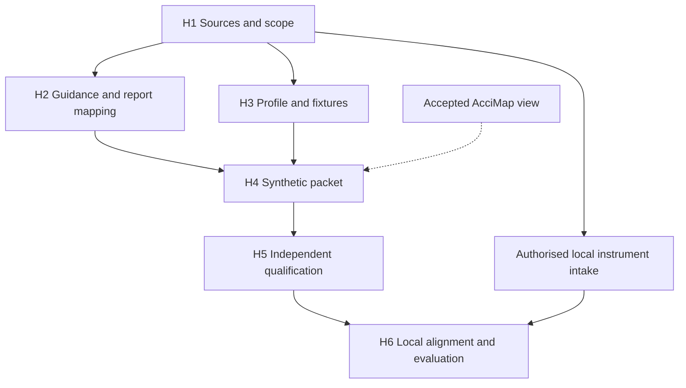

# Implementation order and parallel work

## Delivery sequence

| Stage | Deliverable | Starts after | May run alongside |
| --- | --- | --- | --- |
| H1 | Source applicability, review scope and interface/ownership agreement | Planning handoff and fresh ownership check | Existing D0 and AcciMap owners' work, within WIP limits |
| H2 | Portable workflow and original report mapping | H1 | H3 in disjoint files |
| H3 | Versioned profile and independent synthetic fixture design | H1 | H2 in disjoint files |
| H4 | Deterministic synthetic packet and receipt | H2 + H3; accepted core interfaces actually consumed | Optional view work only after its interface acceptance |
| H5 | Independent execution, strict checks and coordinator integration | H4 | Local-instrument acquisition if authorised |
| H6 | Local-template conformity and conditional shadow evaluation | H5 + current instrument + applicable authority | Source preparation H6.1 can begin after H1 |

The graph is a logical dependency plan. H2/H3 prerequisites and H4 are integrated through PR #142; [observed acceptance](./h4-acceptance-20261117.md) binds passing checks to the actual merge. H5 independent qualification and handoff is next. H4 uses prestructured synthetic records and does not compose optional D0/D1/D2 or AcciMap capabilities. Portfolio numbering and unrelated scientific ownership remain separate.

## Capability-specific dependencies

| Capability wanted in HEAPS | Required accepted evidence | Behaviour while unavailable |
| --- | --- | --- |
| Canonical record/reference validation | Existing canonical schema and selected core interfaces at pinned revisions | Fail invalid structure; no clinical inference |
| Exact source/version/byte-span verification | Track 13 D0 acceptance | Record-level/reference integrity only; no span-verification claim |
| Automatic extraction of explicit observations | D1 | Use prestructured synthetic observations |
| Automatic uncertain chronology | D2 | Preserve supplied times/partial order and unknowns |
| Actor-specific information at a cutoff | D3 | Do not create a decision-time reconstruction claim |
| Generated suggestions or model verification | Applicable Track 12 component and D4 | Deterministic preparation and human questions |
| Optional multilevel AcciMap | Accepted #139 interface and HEAPS mapping | Omit optional view |
| Qualified D6 composition | D6 and all consumed component receipts | Call H4 a bounded synthetic packet only |
| CHHHS template conformity | Current authorised instrument and mapping acceptance | Original draft, conformity unverified |
| Live assistance | Exact local authority, data controls and practice-evaluation evidence | Synthetic use only |

No HEAPS task waits for the whole of Track 12 or Track 13. No nonfatal HEAPS task waits for Track 14. Death-related profiles may share records and questions while preserving distinct route decisions. Qualification is specific to the exact capability and revision, not inherited from issue closure or CI colour.
